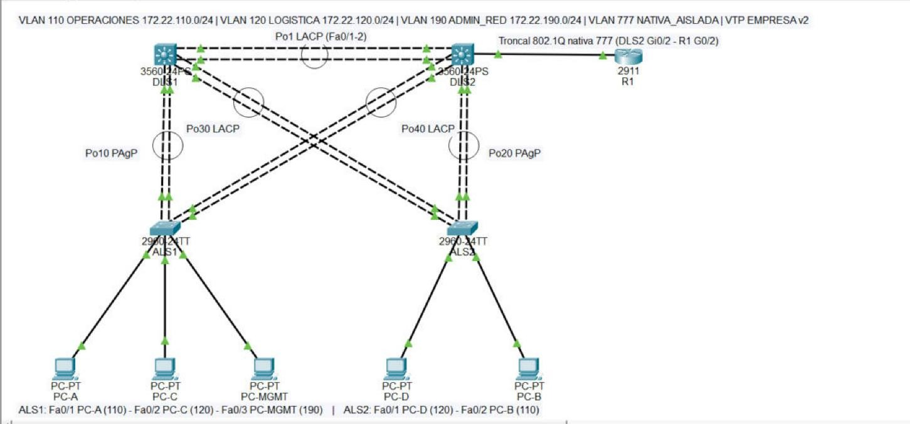
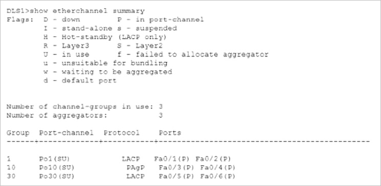
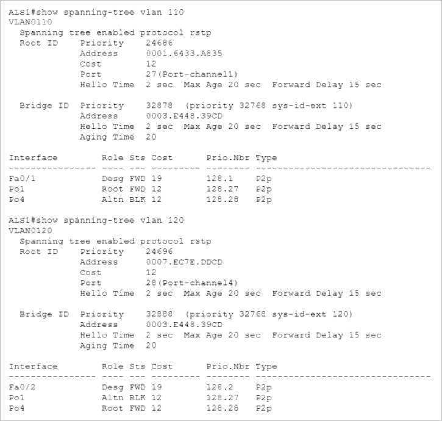
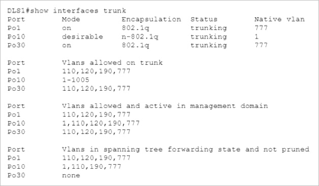
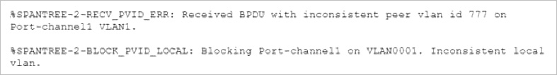

# Switch Block en Cisco Packet Tracer

Diseño, configuración y verificación de un **Switch Block** de campus en Cisco Packet Tracer 9.0: dos switches de distribución, dos de acceso y un router con encaminamiento inter-VLAN en Router-on-a-Stick. Práctica de la asignatura de Encaminadores (noviembre de 2026).



## Qué incluye

| Área | Implementación |
|---|---|
| VLAN | 110 OPERACIONES · 120 LOGISTICA · 190 ADMIN_RED (gestión) · 777 NATIVA_AISLADA |
| EtherChannel | 5 agregados: **LACP** (Po1, Po30, Po40) y **PAgP** (Po10, Po20) |
| Spanning Tree | **Rapid PVST+** con raíces repartidas: DLS1 en las VLAN 110/190/777 y DLS2 en la 120 |
| Inter-VLAN | **Router-on-a-Stick** en R1 (subinterfaces 802.1Q, `.777 native` sin IP) |
| VTP | Demostración controlada con VTPv2 (server / client / transparent) y cierre en transparente con revisión 0 |
| DTP | Negociación `desirable`/`auto` comprobada en un troncal real; después, troncales fijos con `nonegotiate` |
| Securización | Nativa 777 sin uso, solo las VLAN necesarias en los troncales, VLAN 1 fuera de los troncales y puertos sin uso apagados |

## Equipos y direccionamiento

| Equipo | Modelo | Función | Gestión |
|---|---|---|---|
| DLS1 | 3560-24PS | Distribución · raíz STP de las VLAN 110/190/777 | 172.22.190.11 |
| DLS2 | 3560-24PS | Distribución · raíz STP de la VLAN 120 · troncal hacia R1 | 172.22.190.12 |
| ALS1 | 2960-24TT | Acceso (PC-A, PC-C, PC-MGMT) | 172.22.190.13 |
| ALS2 | 2960-24TT | Acceso (PC-B, PC-D) | 172.22.190.14 |
| R1 | 2911 | Puertas de enlace .1 de cada VLAN | 172.22.190.1 |

| VLAN | Red | Puerta de enlace | Equipos finales |
|---|---|---|---|
| 110 | 172.22.110.0/24 | 172.22.110.1 | PC-A .21 · PC-B .22 |
| 120 | 172.22.120.0/24 | 172.22.120.1 | PC-C .21 · PC-D .22 |
| 190 | 172.22.190.0/24 | 172.22.190.1 | PC-MGMT .50 y las SVI de los switches |

| Agregado | Extremos | Protocolo |
|---|---|---|
| Po1 | DLS1 Fa0/1-2 ↔ DLS2 Fa0/1-2 | LACP (active/passive) |
| Po10 | DLS1 Fa0/3-4 ↔ ALS1 Fa0/21-22 | PAgP (desirable/auto) |
| Po30 | DLS1 Fa0/5-6 ↔ ALS2 Fa0/21-22 | LACP |
| Po20 | DLS2 Fa0/3-4 ↔ ALS2 Fa0/23-24 | PAgP |
| Po40 | DLS2 Fa0/5-6 ↔ ALS1 Fa0/23-24 | LACP |

## Verificación

- Los cinco EtherChannel en **(SU)** con todos sus miembros **(P)**, también después de reiniciar toda la red.
- En cada switch de acceso hay un uplink **Root** y otro **Alternate (BLK)** por VLAN, distintos según la VLAN: se aprovechan los dos uplinks y no hay bucles.
- **Prueba de fallo:** al caer un miembro de Po10, el agregado sigue activo y STP no recalcula.
- **Conectividad:** dentro de la VLAN (TTL 128), entre VLAN a través de R1 (TTL 127) y de gestión, todo al 100 %.
- **Cambio de VLAN nativa 1 → 777 en directo:** se observaron y resolvieron `%SPANTREE-2-RECV_PVID_ERR`, `BLOCK_PVID_LOCAL` y `%CDP-4-NATIVE_VLAN_MISMATCH`.

| | |
|---|---|
|  |  |
| EtherChannel estable tras reiniciar | Root / Alternate por VLAN en ALS1 |
|  |  |
| Po10 negociado por DTP (n-802.1q) | STP bloquea por nativa distinta durante el cambio |

## Problemas encontrados y cómo se resolvieron

1. **El 2960 solo admite `channel-group` del 1 al 6.** Los números 10/20/30/40 se rechazaban, así que en el acceso se usan los grupos 1 a 4. El número del grupo es local y no tiene por qué coincidir con el del otro extremo.
2. **LACP + `switchport nonegotiate` es inestable en Packet Tracer.** Los miembros entraban y salían del canal (estado I) y provocaban recálculos continuos de STP. Lo aislé probando por separado: con PAgP no ocurre, y quitando `nonegotiate` solo en los agregados LACP se estabilizan. Esos troncales siguen siendo fijos (`mode trunk`), con nativa 777 y solo las VLAN permitidas.
3. **La raíz de la VLAN 777 la tomaba un switch de acceso,** porque sin prioridad configurada gana la MAC más baja. Se resolvió fijando la prioridad también en la VLAN nativa.
4. **VLAN «VLAN0190» en el cliente VTP.** Con dos servidores en VTPv2, el segundo anunció el nombre por defecto con una revisión mayor. Muestra por qué es arriesgado tener varios servidores en VTPv2.

## Contenido del repositorio

```
topologia/   FERREIRA_FERNANDEZ_ALVARO_SwitchBlock.pkt (abrir con Packet Tracer 9.0) e imagen
configs/     running-config final de DLS1, DLS2, ALS1, ALS2 y R1
docs/        informe técnico completo en PDF (pruebas, capturas e interpretación)
capturas/    capturas clave de la verificación
```

## Autor

Álvaro Ferreira Fernández
